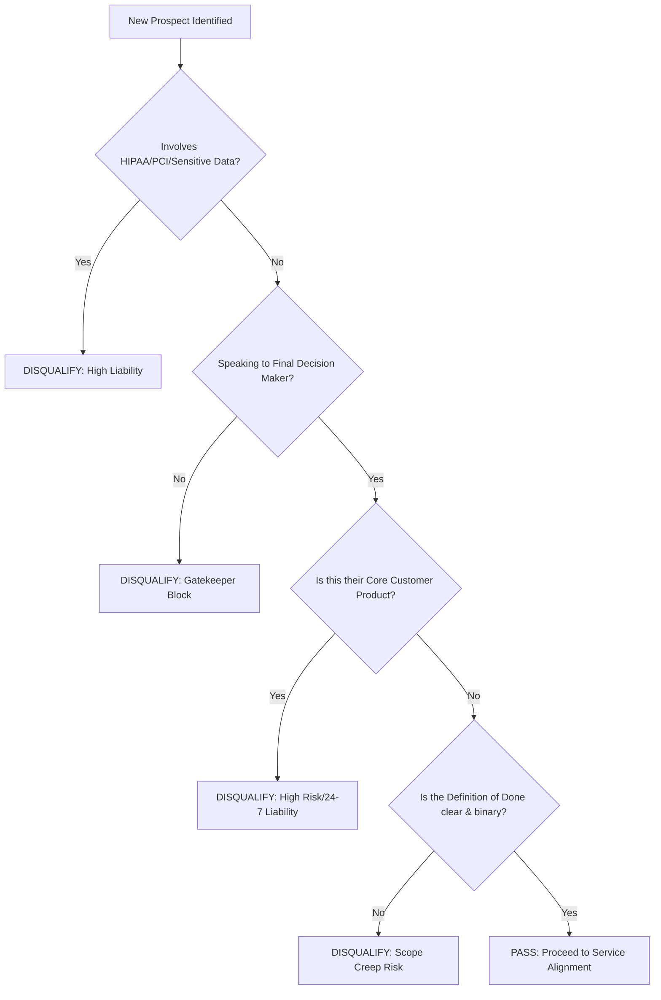
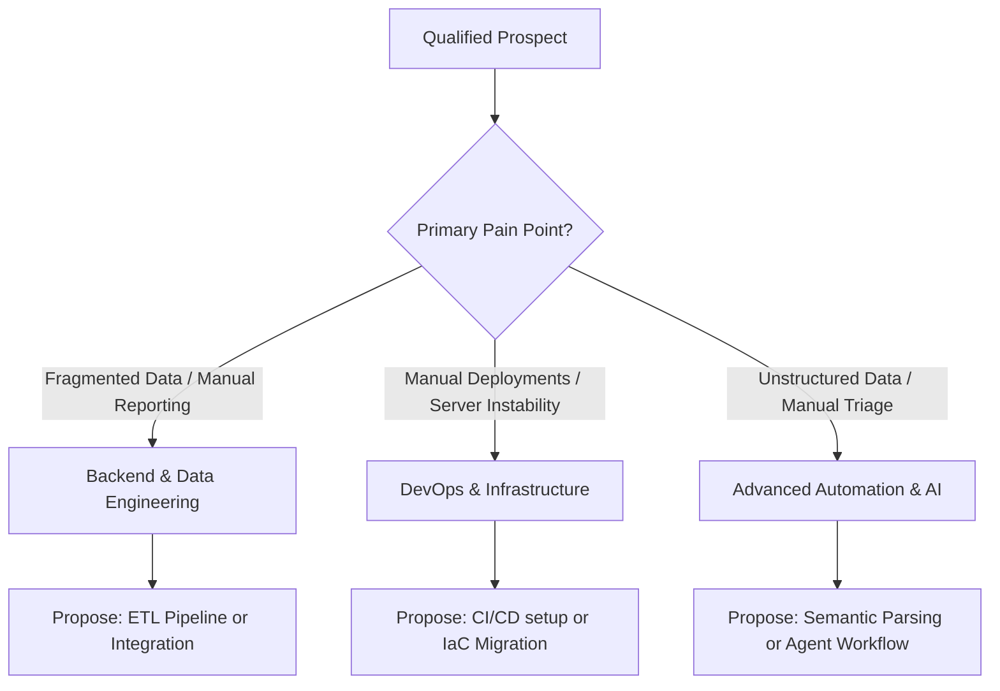
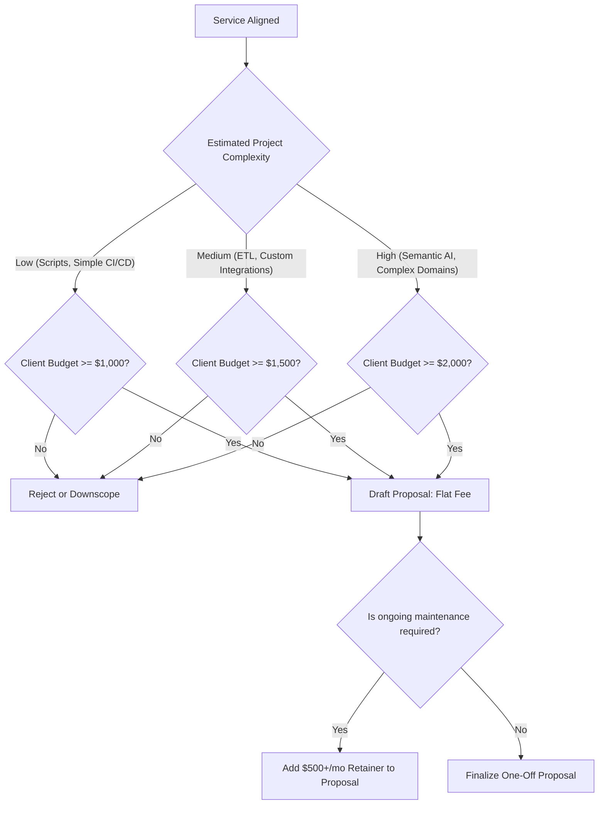

# Decision Matrix Workflows

This document visualizes the evaluation pipeline for consulting prospects. It serves as the blueprint for the programmatic JSON decision matrix.

## 1. Primary Qualification Pipeline (The "Kill Switch")

This flowchart demonstrates the immediate binary filters applied to any new lead.

## 2. Service Alignment & Categorization

Once a prospect passes the kill switch, their primary pain point determines the service alignment.

## 3. Financial Viability & Proposal

The final check before drafting a proposal ensures the project meets the minimum financial floor.

