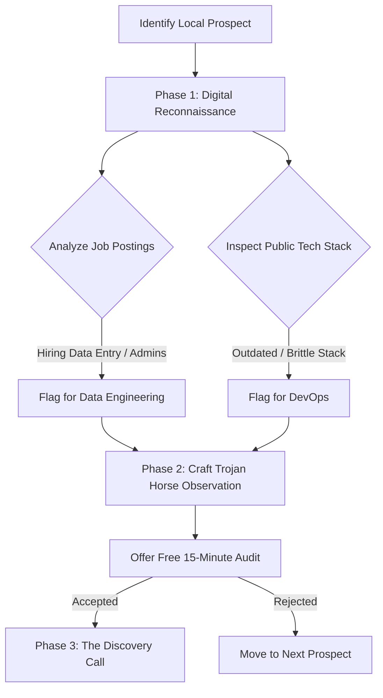
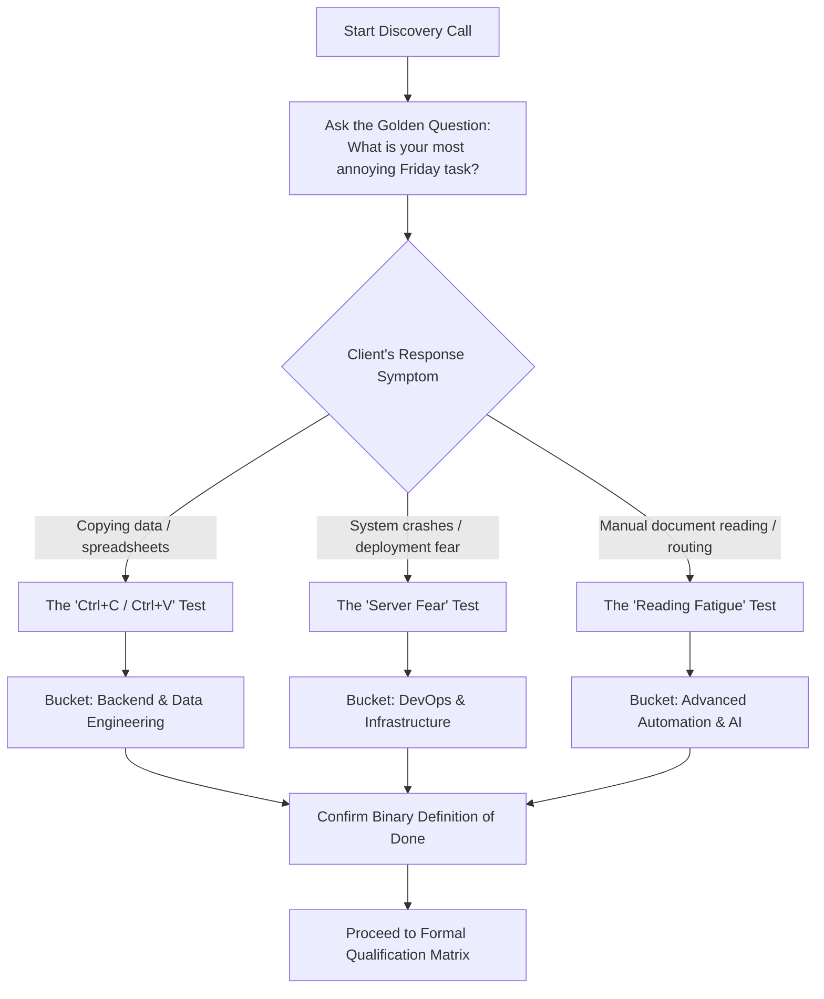
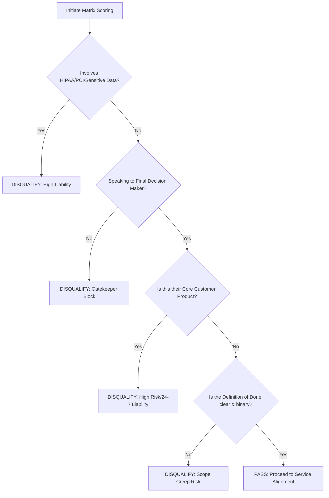
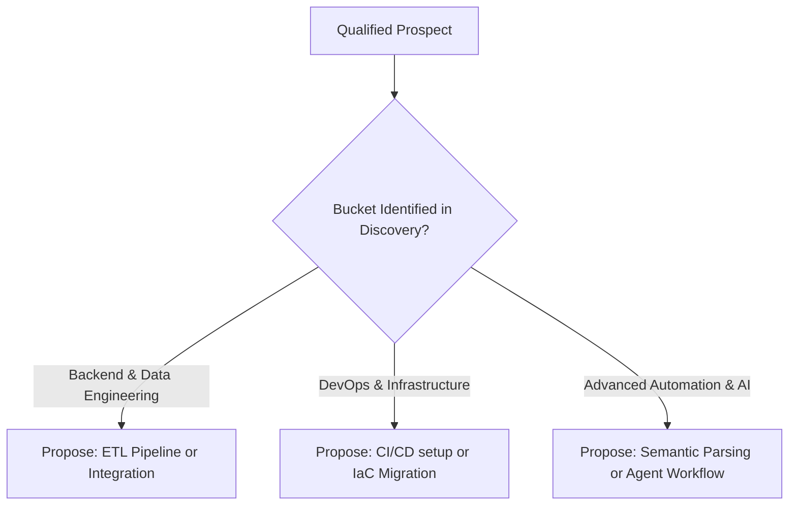
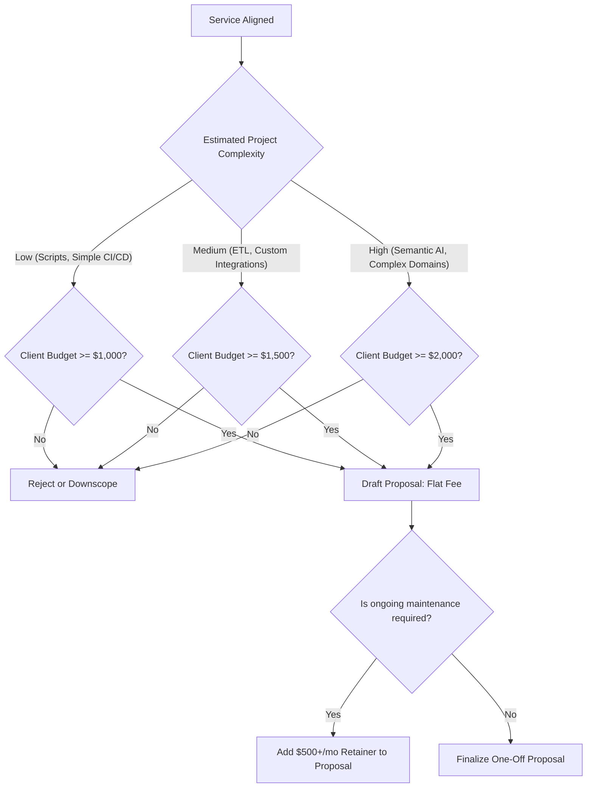
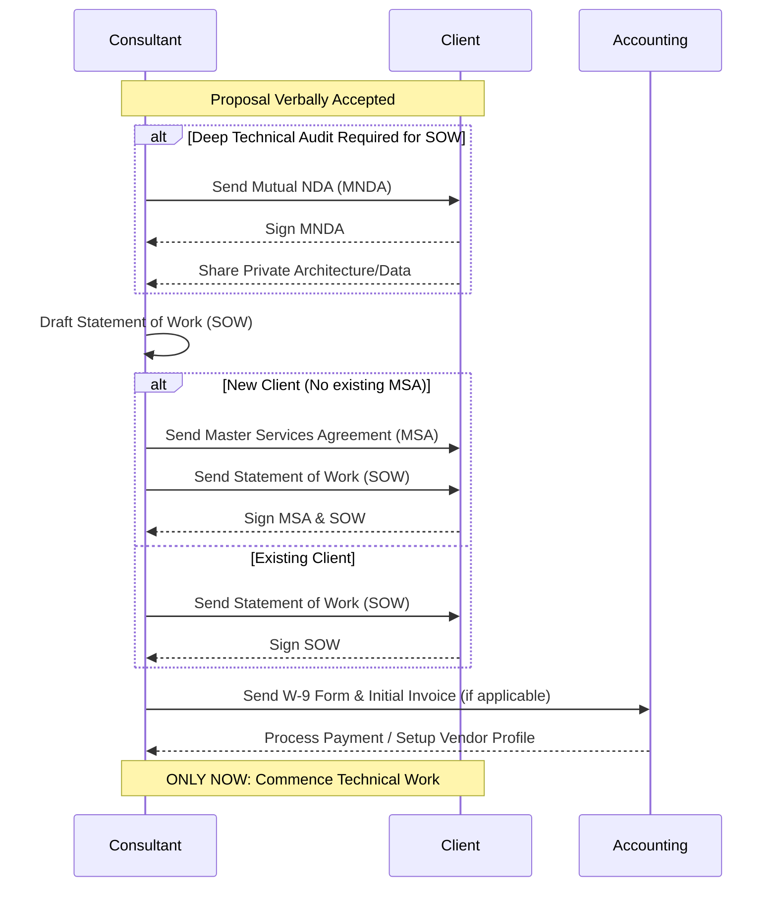

# Decision Matrix Workflows

This document visualizes the evaluation pipeline for consulting prospects. It serves as the blueprint for the programmatic JSON decision matrix, from initial discovery to final proposal, and through legal onboarding.

## 1. Systematized Discovery Sequence

This flowchart demonstrates the passive and active intelligence gathering phases before a formal evaluation begins.

## 2. Symptom Testing Logic (The Discovery Call)

During the Discovery Call, technical jargon is avoided in favor of operational symptom testing.

## 3. Primary Qualification Pipeline (The "Kill Switch")

This flowchart demonstrates the immediate binary filters applied to the prospect's request after the discovery call.

## 4. Service Alignment & Categorization

Once a prospect passes the kill switch, the bucket identified in the Symptom Test dictates the service proposed.

## 5. Financial Viability & Proposal

The final check before drafting a proposal ensures the project meets the minimum financial floor.

## 6. Legal Execution & Onboarding Workflow

Once a client verbally accepts a proposal, this strict sequence dictates the legal paperwork execution before any technical work begins.

