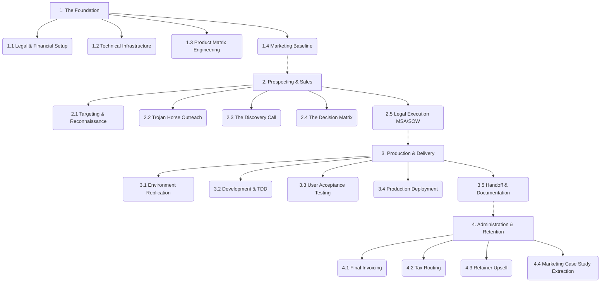

# Master Business Pipelines

This document outlines the four sequential, holistic Master Pipelines that govern the entire lifecycle of the consulting business—from initial corporate setup to post-project retention.

## Pipeline Architecture Visualization

## Master Pipeline 1: The Foundation (Business Setup & Offer Design)
*This is Phase 0. Run this pipeline once to build the operational machine.*
*   **1.1 Legal & Financial Setup:** EIN, LLC filing, Bank Account, Insurance, W-9.
*   **1.2 Technical Infrastructure:** GitHub Org setup, Professional Email, Docker/VM standardized templates, Agentic CLI setups.
*   **1.3 Product Matrix Engineering:** Defining the 3 core buckets (Data, DevOps, AI), setting the flat-fee floors ($1,000+), and building the SOW templates for each.
*   **1.4 Marketing Baseline:** Launching the 3-page portfolio site showcasing project audits.

## Master Pipeline 2: Prospecting & Sales (Lead to Signature)
*This pipeline governs how leads are found, qualified, and legally secured.*
*   **2.1 Targeting & Reconnaissance:** Scraping local job boards for manual labor roles, inspecting public tech stacks.
*   **2.2 The "Trojan Horse" Outreach:** Cold outreach offering a hyper-specific 15-minute technical audit.
*   **2.3 The Discovery Call:** Executing operational symptom tests.
*   **2.4 The Decision Matrix:** Programmatically evaluating the prospect against strict kill criteria (HIPAA, non-decision makers).
*   **2.5 Legal Execution:** Sending the Mutual NDA (if needed) -> Sending the MSA -> Sending the SOW with binary definitions of done -> Initial Invoice.

## Master Pipeline 3: Production & Delivery (Signature to Handoff)
*This pipeline governs how technical work is executed while avoiding scope creep.*
*   **3.1 Environment Replication:** Spinning up isolated Docker containers to mirror the client's architecture.
*   **3.2 Development & TDD:** Building the pipeline or scripts locally.
*   **3.3 User Acceptance Testing (UAT):** Providing the client a staging link to verify the binary "Definition of Done" has been met. *(No production push without UAT sign-off).*
*   **3.4 Production Deployment:** Moving code to the live environment safely.
*   **3.5 Handoff & Documentation:** Delivering standard operating procedures (SOPs) to the client, ending the flat-fee SOW.

## Master Pipeline 4: Administration & Retention (Post-Delivery)
*This pipeline governs capital retention and long-term client value extraction.*
*   **4.1 Final Invoicing:** Triggering the final bill upon deployment. (IP transfers only when paid).
*   **4.2 Tax & Accounting Routing:** Moving estimated taxes (~30%) into a separate holding account immediately.
*   **4.3 The Retainer Upsell:** Proposing a monthly maintenance SOW to keep the new system updated (converting one-off cash into recurring revenue).
*   **4.4 Marketing Extraction:** Securing a signed Marketing Release Form to convert the project into a public case study.
